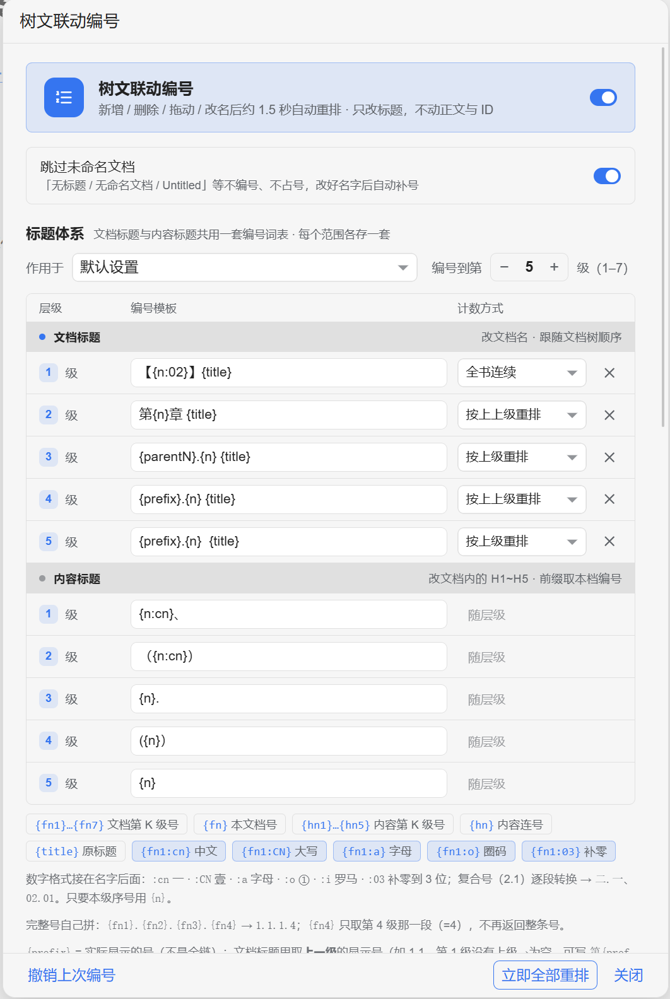

# Tree-Doc Numbering (tree-doc-numbering)




---

## 1 In One Sentence

A linked numbering scheme for child-document titles in the SiYuan document tree **and** for heading blocks inside those documents. Set a scope once; creating, deleting, dragging or renaming documents renumbers everything automatically. Only titles change — document IDs, body blocks and backlinks stay untouched. Document merge and split is built in and shares the same numbering configuration.

## 2 What It Does

| Feature | Description |
|---|---|
| 2.1 Automatic tree numbering | Right-click a document or a whole notebook to define a scope; creating / deleting / dragging / renaming renumbers the whole subtree about 1.5 s later, with no dialog |
| 2.2 Built-in scheme | 5 levels by default, **limit 7** (press + twice for levels 6/7); each level has its own template and counter mode |
| 2.3 Body-heading numbering | H1–H5 inside a document get prefixes taken from the chapter / section number in the document title; `Ctrl+Alt+1…5` sets a level and recalculates the whole document |
| 2.4 Automatic body renumbering | After heading blocks change, only the affected document is recalculated after a 1.5 s pause; documents outside the scope are never touched |
| 2.5 Follows custom sort order | Numbering order at every level is the order currently shown in the document tree; dragging a document renumbers it |
| 2.6 Exclusions | Exclude one document (children still numbered) or a whole branch; excluded documents neither get nor consume a number, and old prefixes are stripped |
| 2.7 Format changes heal themselves | Switching templates or reducing levels strips the old prefix before applying the new one, so no doubled numbers appear |
| 2.8 Two undo chains | "Undo last numbering" restores document titles, "Undo last body numbering" restores body headings; auto-numbering pauses after an undo |
| 2.9 Titles only | Document ID, ID path, body block IDs, child/grandchild IDs and backlinks are unchanged |
| 2.10 Metadata for other plugins | **All state lives in one JSON attribute `custom-doc-num-meta`**: doc blocks hold `rootID` / `rootNum` / `targetId` / `num` / `pad` / `head`, body headings hold `bn`; `siyuan-xref` uses it for scope levels. The attribute panel drops from 5 entries to 1 |

| 2.12 Document Merge & Split | A second submenu with split-to-children / split-to-siblings / merge-children / merge-into-one, sharing the same numbering configuration |
| 2.13 Number vs. Text Isolation | Plugin numbers live in the single JSON block attribute (`head` / `bn`) and are removed precisely; years, version numbers and amounts at the start of your heading are never mistaken for old numbers |
| 2.14 Event Scope Isolation | Tree-numbering events never trigger body-heading numbering; body numbering only affects the current document |
| 2.15 Batch Writes | Read block order, then one batch block update and one batch attribute write instead of per-block requests |

### 2.11 Built-in Scheme (5 Levels by Default, Limit 7) and Counter Modes

All child documents inside a selected scope are numbered by level. **Built-in numbering scheme**: 5 levels by default, limit 7 (press + twice to enable levels 6/7):

| Level | Template | Counter mode | Example |
|---|---|---|---|
| 1 | `{n}【{title}】` | continuous through the whole tree | `1【Introduction】` |
| 2 | `【{n}】{title}` | restart per parent | `【1】Background` |
| 3 | `第{n}部 {title}` | restart per parent | `第1部 Experimental design` |
| 4 | `第{n}章 {title}` | **restart per grandparent** | `第3章 Measurement` |
| 5 | `第{parentN}.{n}节 {title}` | restart per parent | `第3.1节 Sampling` |
| 6 | `{prefix}.{n} {title}` | restart per parent | `1.2.3 Sub-item` |
| 7 | `{prefix}.{n} {title}` | restart per parent | `1.2.3.1 Detail` |
| 8 and deeper | left unchanged | — | — |

Three counter modes, selectable per level in the settings panel:

- **Continuous (`global`)**: one running count for the same level across the whole tree; changing parent does not restart at 1.
- **Restart per parent (`local`)**: starts at 1 under each new parent document.
- **Restart per grandparent (`grandlocal`)**: changing parent keeps counting; only changing grandparent restarts at 1. Level 4 ("chapter") uses it, so chapters under the same `【1】` continue 1, 2, 3… across several "parts", and only restart under `【2】`.

In `第1.1节` the first number is the **parent chapter number** (`{parentN}`) and the second is the **section number** (`{n}`, restarted per chapter). Only levels 1–5 are enabled by default; levels 6 and 7 appear after pressing + twice and default to `{prefix}.{n} {title}` with "restart per parent". All seven levels are editable (English, number after the title, different separators — see 7.4).

> **Upgrade note**: when upgrading from an earlier version, only configurations that were **never customised** are migrated once to the new defaults (settings only, **no document titles are changed**). Customised formats are left alone; use "Restore built-in defaults" in the panel to switch.

**Body headings**: heading blocks inside documents can also be numbered (H1 `1.1.1` / H2 `1.1.1.1` / H3 `（1）` / H4 `1）` / H5 `①`), with the prefix taken automatically from the section or chapter number in the document title: `Ctrl+Alt+1…5` triggers it manually; it can also run automatically — heading changes in scoped documents are recalculated after a 1.5 s pause (see 7.5).

## 3 Problems It Solves in SiYuan

| SiYuan out of the box | Tree-Doc Numbering |
|---|---|
| 3.1 No level-based automatic numbering; numbers must be typed | Define a scope once with a right-click; structural changes trigger renumbering |
| 3.2 Custom sort order in the tree and numbers in titles are unrelated — one drag breaks everything | Every level uses the order currently shown in the tree; dragging renumbers it |
| 3.3 Prefixes such as `1.1.1 / （1） / ①` must be typed and maintained by hand | Prefixes come from the chapter / section number in the document title and refresh when the title changes |
| 3.4 `Ctrl+Z` cannot undo renames written through the API | The plugin has its own undo, restoring old titles document by document |
| 3.5 Using `updateBlock` to rename a document can wipe its whole body | Only `renameDocByID` is used; IDs and body content stay intact |
| 3.6 SQL indexes lag 0.6–2 s right after creation/deletion, so queries return stale structure | Collection walks the file tree recursively instead of querying subtree paths via SQL |

## 4 How It Compares

Only approaches are compared here; **third-party numbering plugins were not tested individually** [To be confirmed: see each plugin's own documentation].

| Aspect | Hand-written numbers | SiYuan native | Tree-Doc Numbering |
|---|---|---|---|
| 4.1 Who maintains numbers | You | No such feature | The plugin renumbers from the document tree |
| 4.2 After dragging a document | Edit the whole book | — | Automatic renumber after ~1.5 s |
| 4.3 Body-heading prefixes | Typed | None | Taken from the chapter / section number in the title |
| 4.4 Counter modes | Whatever you decide | — | Continuous / restart per parent / restart per grandparent, per level |
| 4.5 Undo | Repeated `Ctrl+Z` | `Ctrl+Z` cannot undo API writes | Two built-in undo chains |
| 4.6 What gets changed | Risk of touching body content | — | Titles only; IDs, body and backlinks unchanged |

In one line: for **deep book structures that are often dragged or reformatted**, this plugin saves the most work; for numbering two or three documents once, typing them is faster.

## 5 Requirements and Setup

### 5.1 Requirements

| Dependency | Version | Notes |
|---|---|---|
| SiYuan | **3.8.9 (tested)** | Desktop only (`frontends: desktop` / `desktop-window`); older versions, mobile and web are untested [To be confirmed] |
| External programs | **None** | No Zotero, no other plugin, no external service |
| Optional integration | Cross-reference plugin (`siyuan-xref`) | Reads scope config and `custom-doc-num-meta` through the global `__siyuanDocNumTest` hook; works without it too |

### 5.2 First-time Setup

**Install**: unzip `package.zip` into `data/plugins/tree-doc-numbering/` in your SiYuan data directory (the files must be at the root level of the extracted folder), then enable it under "Settings → Marketplace → Downloaded" and reload the UI. Only SiYuan 3.8.9 has been tested; older versions are untested [To be confirmed].

1. Unzip `package.zip` into `data/plugins/tree-doc-numbering/`. **The files must sit directly at the root** — an extra containing folder prevents the plugin from loading after installation.
2. Enable "Tree-Doc Numbering" in "Settings → Marketplace → Downloaded" and reload the UI.
3. Right-click the target document (or a whole notebook) in the document tree → "Set as auto-numbering scope (renumber on create/delete/drag)". One numbering pass runs immediately.
4. Click the **≡ list icon** in the top bar (`子文档自动编号`) to open the panel; adjust levels, templates and counter modes, then click "Save and apply".

> **Upgrading from the old name**: the package name is `tree-doc-numbering`. SiYuan treats it as a new plugin: copy the configuration from `data/storage/petal/siyuan-plugin-doc-num/` to `data/storage/petal/tree-doc-numbering/` and disable the old plugin, otherwise two instances would renumber the same tree twice.

### 5.3 Settings

| Setting | Purpose |
|---|---|
| Master switch | Pause / resume automatic numbering; the panel fades while paused |
| "Apply to" | "Default settings" or one specific scope — templates / levels / counter modes are **stored per scope** |
| Number up to level N | `−` / `+` between 1 and 5; the row-end `×` deletes a level |
| Template per level | `{n}` `{nn}` `{parentN}` `{parentNN}` `{title}` `{prefix}`; tree tokens `{fn1}~{fn7}` / `{fn}`, body tokens `{hn1}~{hn5}` / `{hn}` |
| Counter mode per level | Continuous / restart per parent / restart per grandparent |
| Body-heading section | Enable `Ctrl+Alt+1…5`, auto-recalculate after heading changes, "Number now" (dry-run count first), undo last body numbering |
| Scope and exclusion lists | Review and remove existing scopes / exclusions |
| Bottom action bar | Save and apply, restore built-in defaults, renumber all now, undo last numbering |

## 6 Entry Points and Shortcuts

| Entry / command | How to trigger | Shortcut |
|---|---|---|
| 6.1 Set a paragraph to heading level N and number it | Put the caret in a body paragraph | `Ctrl+Alt+1` … `Ctrl+Alt+5` (can be disabled in the panel) |
| 6.2 Open the settings panel | Top-bar **≡ list icon** (`子文档自动编号`) | — |
| 6.3 Set / cancel an auto-numbering scope | Right-click a document or notebook in the tree | — |
| 6.4 Number manually / undo last numbering | Right-click a document (a notebook also offers "number the whole notebook") | — |
| 6.5 Exclude / un-exclude | Right-click a document (itself / whole branch) | — |
| 6.6 Five body-numbering commands in the command palette | Command palette; registered as `docNumBody1`…`docNumBody5` | Unbound by default; assignable under "Settings → Shortcuts → Plugins" [To be confirmed: displayed command names] |
| 6.7 Renumber all now / number now / both undos | Bottom action bar of the settings panel | — |

There is no slash command; all entries live in the document-tree context menu, the top-bar panel and the command palette.

## 7 Usage

### 7.1 Automatic Numbering

1. In the left document tree, **right-click the parent document** (numbering applies to its descendants); you may also **right-click a notebook** (all its documents are numbered, with root-level documents treated as level-1 "parts").
2. Choose **"Set as auto-numbering scope (renumber on create/delete/drag)"**. One pass runs immediately.
3. Afterwards, **creating, deleting, dragging or renaming** a document in the scope renumbers the whole subtree after about 1.5 seconds, without dialogs.
4. To stop: right-click the same document / notebook → "Cancel auto-numbering for this scope".
5. For a one-off pass: right-click a document → "Number child documents with the configured format"; right-click a notebook → "Number the whole notebook".

Multiple scopes can coexist. The **≡ list icon** opens the panel with the master switch, scope list, "Renumber all now" and "Undo last numbering".

### 7.2 Manual Numbering (still available)

Right-click a document → "Number child documents with the configured format". Right-click any document → "Undo last child-document numbering".

> After an undo, **automatic numbering pauses**; otherwise the rename events caused by the undo would be written back 1.5 s later. Re-enable the switch in the top-bar panel to continue.

### 7.3 Excluding Documents

Right-click a document in the tree:

| Menu item | Effect |
|---|---|
| "Exclude this document (not itself, children still numbered)" | The document gets no number and consumes none; **its children are still numbered** (levels do not collapse) |
| "Exclude this document and its children" | The whole branch gets no number and consumes none |
| "Cancel exclusion" | Numbering resumes without stacking prefixes |

When excluding, existing prefixes in that scope are stripped to restore the original title, avoiding collisions such as `第02章 Appendix` next to a renumbered `第02章 Something`. Exclusions can be reviewed and removed in the panel.

> Real-world pitfall: a notebook node in SiYuan's tree has an **empty** `data-node-id`; the notebook ID lives on the parent `<ul data-url>`. The first version read `data-node-id`, so the context menu never appeared for notebooks. It now detects the node type via `data-type` and reads the ID from the parent `ul[data-url]`.

### 7.4 Custom Formats and Levels


Open the panel via the **≡ list icon**. It follows SiYuan's native dialog layout: a **status card** on top (master switch, faded while paused), a **scrolling settings area** (format table, live preview, scope and exclusion lists) and a **fixed action bar** at the bottom. All controls use native `b3-*` components and `--b3-theme-*` variables, so light and dark themes work automatically; no emoji, no hard-coded colours.

In "Numbering formats and levels":

1. "Apply to" selects **default settings** (for new scopes / manual numbering) or **one specific scope**. Formats, level count and counter modes are **stored separately per scope**.
2. "Number up to level `−` `5` `+`": `−` / `+` change the count between **1 and 7**; more levels add rows, fewer remove them (defaults to 5).
3. Each row has a **format template** on the left and a **counter mode** on the right:
   - Continuous — same level keeps counting through the whole tree (default for level 1)
   - Restart per parent — restarts at 1 under each new parent (default for levels 2, 3, 5)
   - Restart per grandparent — continues across parents, restarts at a new grandparent (default for level 4 "chapter")
   - The **× (delete number)** at the far right removes that level; later templates and modes shift up and the level count drops by 1. Removing the last level behaves like `−` (the template is kept and `+` brings it back). With only one level left the button is disabled. Click "Save and apply" to write and renumber.
4. A live preview shows the current settings. **"Save and apply"** renumbers immediately; **"Restore built-in defaults"** resets templates, counter modes and level count to the built-in default (5 levels; the limit stays 7).

| Placeholder | Meaning | Example with number 3 and parent number 1 |
|---|---|---|
| `{nn}` | zero-padded to two digits | `03` |
| `{n}` | no padding | `3` |
| `{parentN}` | **number of the parent document** | `1` |
| `{parentNN}` | parent number, zero-padded | `01` |
| `{title}` | original title | `Introduction` |

Copy-paste examples (one line per level):

```
Built-in: {n}【{title}】 【{n}】{title} 第{n}部 {title} 第{n}章 {title} 第{parentN}.{n}节 {title}
Legacy: 第{nn}部 {title} 第{nn}章 {title} 第{nn}节 {title} 第{nn}条 {title} 第{nn}款 {title}
English: Chapter {nn} - {title} Sec {n}: {title} {nn}. {title} §{n} {title} {parentN}.{n} {title}
Number last: {title}（第{nn}部） {title}【{n}】 …
```

- **Changing formats or reducing levels strips old numbers first**, so nothing becomes `1【第01部 Introduction】`; levels beyond the configured count return to their original titles.
- **Known trade-off**: the built-in templates use unpadded `{n}`, so a hand-written `第1章` looks exactly like a generated one and is stripped as a plugin prefix. Chinese numerals (`第一章`) and decimals (`第1.1 Results`) are unaffected. To keep hand-written numbers, switch that level's template to padded `{nn}`.
- Paired stripping: for "prefix + suffix" templates like `{n}【{title}】`, the suffix is removed only when the prefix matched, so a hand-written trailing `】` is safe.
- If `{title}` is missing it is appended automatically; an empty template falls back to the built-in default — the plugin never creates a title containing only a number.
- **Placeholder titles** (`无标题` / `无命名文档` / `未命名文档` / `Untitled`) are skipped and consume no number; once renamed they get a number. Placeholder documents that already carry an old prefix are stripped first. This can be disabled in the panel.
- Details are in `格式模板约定.md` (Chinese).

### 7.5 Numbering Body Headings

Heading blocks (H1–H5) inside a document receive numbers whose prefix is taken from the **section or chapter number in the document title**:

| Level | Default template | Logic | Example (document `第1.1节 Sampling`) |
|---|---|---|---|
| H1 | `{prefix}.{n}` | section/chapter number + own index | `# 1.1.1 Sample preparation` |
| H2 | `{h1}.{n}` | parent H1 number + one segment | `## 1.1.1.1 Cleaning` |
| H3 | `（{n}）` | restart per parent H2 | `### （1） Rinse with water` |
| H4 | `{n}）` | restart per parent H3 | `#### 1） Water temperature` |
| H5 | `{cn}` | restart per parent H4 | `##### ① Details` |
| H6+ | not numbered | — | — |

- **`Ctrl+Alt+1…5`** turns the current paragraph into a level-N heading and **cascades a recalculation of every heading in the document** (only blocks whose number actually changed are written; idempotent).
- If the document title has only a chapter number, that is used: in `第3章` H1 becomes `3.1` and H2 `3.1.1`.
- **Three prefix forms are recognised**: `第2.1节 …`, `第3章 …`, and a plain numeric start such as **`2.1 …`** (produced by the level-2 tree template `{parentN}.{n} {title}`). The numeric form requires a decimal point followed by a space or a Chinese punctuation mark, so `2024 Annual report` or `3 methods` is not misread.
- **Documents with neither section nor chapter number are skipped** rather than given an invented prefix.
- Templates are customisable per level in the panel ("Body heading numbering"), with `{prefix}` (section/chapter number), `{n}` (own index), `{h1}` (parent level-1 number), `{cn}` (①②…) and `{title}`. With `{title}` the template controls the position; without it the number is prepended and a space is added after the digits.
- **"Undo last body numbering"** is available both in the bottom action bar and in the body area; it restores the most recent round block by block. After a successful undo, **automatic body renumbering pauses** and must be re-enabled in the panel.

> **Safety gates (from a real incident on 2026-11-07)**: never number a block whose text cannot be read, never write a block that would contain only `#` after stripping, refuse when the caret is on the document root, and skip undo records with empty originals. All body writes go through `updateBlock` one block at a time and stop on interruption — no "half-numbered then continue" behaviour.

### 7.6 Automatic Body Renumbering

The "Body heading numbering" section has a **"Recalculate after heading changes"** switch (off by default):

- **Scope is shared with auto-numbering scopes**: a document scope means that document **and all its children** (same semantics as tree numbering); documents outside the scope are never touched.
- **Trigger**: SiYuan pushes a `savedoc` event on save (carrying the document ID). Only heading-block edits / deletions enter the queue; ordinary paragraph edits are ignored. After a **1.5 s pause** only the affected document is recalculated, so numbers do not jump while typing.
- **Tree-numbering linkage**: when tree numbering renames a document (section/chapter number changes), body prefixes refresh once; undoing the tree change does the same.
- **No self-excitation**: a full recalculation is idempotent and writes only changed blocks; events caused by the plugin's own writes produce an empty plan on the next round. A **circuit breaker** stops automatic numbering for a document after 3 consecutive identical rounds and shows a message; toggle the switch off and on to reset.

### 7.7 "Number Now" and Depth Normalisation

Automatic renumbering only runs when a document is **saved**, so right after installation, documents that have not been edited for a long time have never been numbered at all — not a bug, just never triggered. Two things were added:

- **"Number now"** in the panel: numbers body headings in all documents of the scope. The first click only **previews the counts** (documents, places); the button becomes "Confirm writing N places" and a second click writes. One undo snapshot covers the whole batch.
- **"Renumber all now" handles both**: it numbers document titles from the tree, then body headings in every scoped document. With body numbering disabled, only document titles are handled. The two undo chains remain independent.
- **Depth normalisation inside a document**: when a document has **no H1** (common for section-level documents that start at H2), the shallowest heading is treated as level 1. The top heading of `第5.1节` becomes `5.1.1` instead of the literal-level `5.1.1.1`. **Documents that do have an H1 get shift=0 and produce byte-identical output to .** The number of `#` characters never changes — only which level's template is applied.

| Heading in document | Before (literal level) | After |
|---|---|---|
| `## Load environment` | `## 5.1.1.1 Load environment` | `## 5.1.1 Load environment` |
| `### Install packages` | `### （1） Install packages` | `### 5.1.1.1 Install packages` |
| `#### Network check` | `#### 1） Network check` | `#### （1） Network check` |

### 7.8 Multi-Level Custom Sort Order (Important)

At **every level** the numbering order is the order currently displayed in the document tree (the `files` array returned by `listDocsByPath`) — not title text, creation time or a `sort` value. Dragging a child document renumbers that level and all affected chapter / section numbers.

To make the order follow your dragging exactly, **switch that level's sort mode to "Custom sort" in the document tree**. If a level is sorted by name ascending/descending, numbering follows that result instead. The plugin never changes notebook sort settings itself.

On drag, SiYuan broadcasts `filetreeSortChanged` with the new `childIDs` order; the plugin numbers from that order before the kernel cache refreshes, avoiding a one-beat delay.

### 7.9 Numbering Rules in Detail

- The **built-in default** enables 5 levels with a limit of 7 (see 2.11), unpadded numbers and `{parentN}` taken from the parent chapter. All 1–7 level templates are editable (see 7.4).
- Each run strips plugin-added numbers before renumbering, which guarantees idempotency and makes prefixes follow a document when it moves to another level.
- Stripping regexes are generated from "current format + last format + last global default + global default + core legacy fallbacks + old hard-coded forms". `{nn}` / `{parentNN}` produce `\d{2,}`, `{n}` / `{parentN}` produce `\d+`; Chinese numerals and hand-written decimals stay safe.
- Prefix + suffix templates (e.g. `{n}【{title}】`) are stripped **as a pair**: the suffix is removed only when the prefix matched, so a hand-written trailing `】` is not eaten.
- **Default level count is 5, adjustable from 1 to 5**; each level can use any of the three counter modes. Documents beyond the configured count lose their number and return to the original title.
- `grandlocal` groups by "level + grandparent ID", so chapter numbers continue across parent (part) changes and restart only at a new grandparent (`【n】`). If the parent itself is excluded or skipped, `{parentN}` degrades to `0` (edge case, documented as-is).
- **Freshly created documents with placeholder titles** (`无标题` / `无命名文档` / `未命名文档` / `Untitled` / `新建文档`, including numbered variants) are not numbered and consume no slot; once named they get a number. This can be switched off in the panel.
- Syncthing `(Conflicted …)` copies are skipped and consume no slot.
- Only child-document titles inside the scope are changed; **the scope root's own title is untouched**, as are body content and document IDs.
- **Overlapping scopes**: if both a document and the notebook containing it are scopes, the outer scope numbers only down to that document node and does not descend into its children — those belong to the more specific scope. Otherwise one document would be rewritten alternately under two level schemes (observed as flickering titles in the tree). Automatic checks also have a circuit breaker that pauses after 3 identical rename rounds.

### 7.10 Titles Only

Tested on SiYuan 3.8.9: renaming uses `/api/filetree/renameDocByID`. **Document ID, ID path, body block IDs and child/grandchild IDs do not change**; only the title and the human-readable path `hpath` are updated. Body content, block references and backlinks are unaffected.

> Anti-pattern: renaming a document block with `updateBlock` deletes the whole body (an actual incident in this project on 2026-10-28). This plugin never calls it.

### 7.11 Undo

SiYuan's `Ctrl+Z` **cannot undo API writes** (its undo stack only records editor-initiated operations). Before renaming, the plugin stores each document's old title in its own data file; "Undo last child-document numbering" restores them one by one. A successful undo clears the record and **pauses automatic numbering** (see 7.2).

### 7.12 Document Merge and Split

Right-click **a concrete document** in the tree and open the **Document Merge & Split** submenu. Existing numbering entries live in the **Tree-Doc Numbering** submenu; the two never mix.

| Entry | Behaviour |
|---|---|
| Split into Child Documents | Split on the highest heading level present; each heading becomes the child document title and is removed from the body, remaining headings are promoted one level, the source keeps only the text before the first heading. No headings → no split |
| Split into Sibling Documents | Same, but as sibling documents; if the emptied source has no preamble it is deleted |
| Merge Child Documents Here | Append children to the end of the parent: document titles become level-1 headings, child headings are demoted one level, children are then deleted |
| Merge into One Document | Select several documents → create a sibling named 合并文档 (auto-suffixed if taken); titles become level-1 headings, contents demoted, sources deleted |

Each pair is the inverse of the other, so repeated split/merge keeps levels, section count and content stable. **All existing numbers are stripped first using this plugin's own formats**, and afterwards **only the documents involved get their body headings renumbered** — no whole-library pass, no unrelated documents touched.

Numbers are isolated from your text with the `bn` field of the **single attribute `custom-doc-num-meta`**: the pure number is stored in that JSON attribute on the heading block (attributes never enter Markdown or exports), and stripping removes exactly that recorded prefix instead of guessing with regexes. Headings such as `2026-11-10 Meeting`, `3.2 Release Notes`, `100 CNY Budget` or `2024-08-09 Field Work` therefore keep their leading numbers. For legacy documents without a marker only unambiguous forms (Chinese numerals / 第N章 / 【N】) are stripped.

Writes are batched: `getDocBlocksOrders` → one `batchUpdateBlock` → one `batchSetBlockAttrs`.

## 8 Limitations

- Defaults to **5 levels**, adjustable to **1–7**; **level 8 and deeper are never numbered** (`MAX_LEVEL = 7`). With the default 5, the fourth and fifth layers also get numbers — set the level count back to 3 if you dislike that.
- Only descendants of a scope root are handled; the root's own title is unchanged. Under a **notebook scope**, each root-level document counts as a level-1 "part" and the notebook name itself is untouched.
- Collection expands at most 2000 nodes / traversal depth 8 (`MAX_NODES` / `MAX_DEPTH`); deeper trees are truncated [To be confirmed: very large manuscripts were not tested]. **The numbering limit is set separately by `MAX_LEVEL = 7`.**
- Automatic triggering relies on SiYuan `ws-main` events; if event names change in a future version it degrades to "manual right-click only" and will not corrupt data.
- With a template like `{n}. {title}`, a hand-written `1. Introduction` is treated as an old plugin prefix and stripped — an inevitable consequence of that format (see `格式模板约定.md` §3). **The built-in `第{n}章` also uses a single digit**, so a hand-written `第1章` is stripped; Chinese numerals (`第一章`) are safe.
- Mouse clicks in the top-bar panel, real tree dragging and real right-clicks have not been directly exercised by a human in tests [To be confirmed]; tests used the same API, the panel DOM and event payloads in the same format as the UI.
- Mobile, the office PC, the laptop and other SiYuan versions are untested; only the **home PC `DESKTOP-PLK096N` / SiYuan 3.8.9 desktop** was tested [To be confirmed].
- **Undo for automatic body numbering keeps only the latest round**: `body-undo-last.json` is overwritten each round, so earlier rounds cannot be undone.
- Manually editing a document title (not via tree numbering) does not immediately trigger body renumbering; it is picked up on the next body change or tree-numbering linkage.
- With automatic renumbering on, pausing mid-word in a heading for more than 1.5 s may attach a number to the half-typed title; the next round converges to the correct form (the number never swallows the title).
- If `bodyAuto` is enabled while other E2E scripts run, tree-numbering linkage also numbers body headings in the test tree (observed; it does not break assertions but occupies the snapshot).
- Creating a heading in the first seconds after a document is created may be skipped by the first automatic round because SQL is not ready; the next event picks it up (prefer skipping over writing something wrong).

---

## 9 License

The repository root contains `LICENSE` (MIT License, Copyright (c) 2026 ttChen). Author: `ttChen` (see `plugin.json`).

---

## Version History

Condensed in English; the full Chinese changelog is in `README.md`.

| Version | Date | Main change |
|---|---|---|
| 1.2.2 | 2026-11-11 | Fix false "3 consecutive rounds" warning in body numbering: idempotency now compares against pre-peel original markdown, so already-numbered headings produce an empty plan and no rewrite loop; 10 new unit tests |
| 1.2.1 | 2026-11-11 | Document-tree numbering limit raised from 5 to 7 levels; 7 template rows, `{fn6}`/`{fn7}`, default stays 5 levels; body headings unchanged |
| 1.2.0 | 2026-11-11 | All plugin state merged into a single JSON attribute `custom-doc-num-meta`; 5 document attributes become 1; xref remains compatible |
| 1.1.2 | 2026-11-11 | Document-tree numbers use block attributes for exact peeling; student IDs / years / dates / digit-only titles are protected |
| 1.1.1 | 2026-11-10 | Merged the document merge/split plugin behind two submenus; block-attribute number isolation, date/version-number protection, batched writes, event-scope isolation; reproducible `fusion/` build layer |
| 0.9.4 | 2026-11-08 | Full bilingual UI: settings panel, context menus, toasts and command names follow `window.siyuan.config.lang`; official `i18n/` files bundled |
| 0.9.3 | 2026-11-08 | Added full English README, made `readme` language-aware, added `README_en.md` to build/deploy/package manifests |
| 0.9.2 | 2026-11-08 | Renamed to 树文联动编号 / tree-doc numbering, package name → `tree-doc-numbering`; config migration and old plugin disabled |
| 0.9.1 | 2026-11-08 | Slimmed `custom-doc-num-meta` to `rootID` / `rootNum` / `targetId`; legacy 5-field values still readable |
| 0.9.0 | 2026-11-08 | Added `targetId` to `custom-doc-num-meta` so xref can override chapter-prefix level per scope |
| 0.8.9 | 2026-11-08 | Introduced the single JSON attribute `custom-doc-num-meta` for all numbering metadata |
| 0.8.8 | 2026-11-08 | Added `rangeDocIdsOrdered()` exposing scope documents in tree order (read-only) |
| 0.8.7 | 2026-11-08 | Stability and responsiveness improvements; no numbering semantics changed |
| 0.8.6 | 2026-11-08 | Added `{prefix}` = the number actually shown on the parent document |
| 0.8.5 | 2026-11-08 | `{fn1}~{fn5}` / `{hn1}~{hn5}` changed to the single number of level K |
| 0.8.4 | 2026-11-07 | Cleaned leading-dot residue such as `..2 2` after repeated template switches |
| 0.8.3 | 2026-11-07 | Attribute number now stores the number shown in the title, not the full chain |
| 0.8.2 | 2026-11-07 | Strip legacy numbers before switching formats; keep multiple historical templates |
| 0.8.1 | 2026-11-07 | Fixed `{h1}` to be a pure number instead of the rendered level-1 template |
| 0.8.0 | 2026-11-07 | Numbers stored in document attributes `custom-doc-num` / `custom-doc-num-pad` |
| 0.7.7 | 2026-11-07 | Recognised three more tree-number shapes as body prefixes |
| 0.7.6 | 2026-11-07 | Fixed strip-priority incident where a literal-only template ate `【3】` |
| 0.7.5 | 2026-11-07 | Broad stability hardening: 11 issues fixed, read-only `diagnose()` added |
| 0.7.4 | 2026-11-07 | Strip hand-written leading numbers (`1.`, `（1）`, `1）`, …) from titles |
| 0.7.3 | 2026-11-07 | Fixed the repeated "number rewritten" toast caused by empty titles |
| 0.7.2 | 2026-11-07 | Built-in level 3 changed from `第{n}部` to `第{n}篇` |
| 0.7.1 | 2026-11-07 | Number output formats (`:cn`, `:CN`, `:a`, `:o`, `:i`, `:03`, …) |
| 0.7.0 | 2026-11-07 | Unified title system; one 10-row table for document and body templates |
| 0.6.3 | 2026-11-07 | Recognise plain numeric section prefixes such as `2.1 Title` |
| 0.6.2 | 2026-11-07 | "Renumber all now" handles both document titles and body headings |
| 0.6.1 | 2026-11-07 | "Number now" with dry-run count, batch undo, in-document depth normalisation |
| 0.6.0 | 2026-11-07 | Automatic body-heading renumbering on `savedoc` with 1.5 s debounce |
| 0.5.0 | 2026-11-07 | Body-heading numbering via `Ctrl+Alt+1…5` |
| 0.4.1 | 2026-11-07 | Fixed tree-title flicker caused by overlapping scopes |
| 0.4.0 | 2026-11-07 | New built-in five-level scheme |
| 0.3.0 | 2026-11-07 | Template + placeholder formats and per-level counter modes |
| 0.2.0 | 2026-11-07 | Auto-numbering scopes, file-tree collection, exclusions |
| 0.1.0 | 2026-11-07 | First release: manual child-document numbering |
